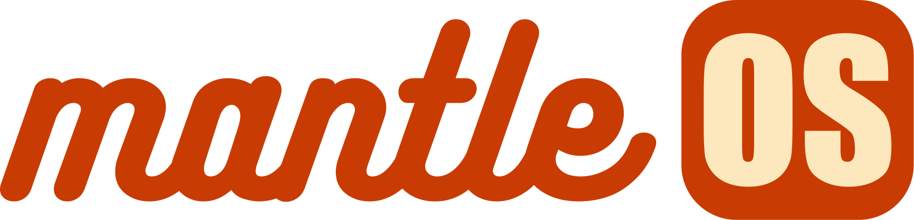
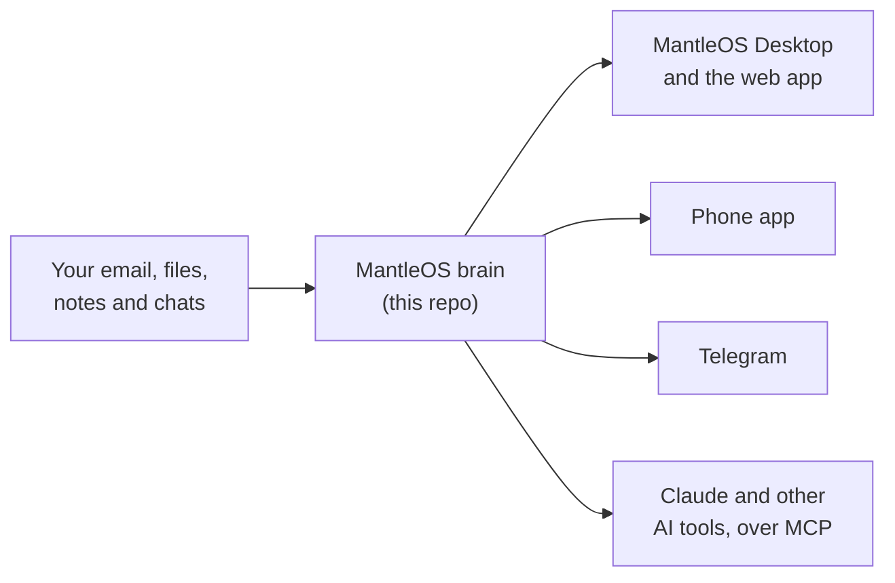

<p align="center">
  <a href="https://mantleos.io"></a>
</p>

<h3 align="center">Makes your data work for you.</h3>

<p align="center">
  MantleOS. The operations system for one person or a whole enterprise.
</p>

<p align="center">
  <a href="https://mantleos.io">Website</a> ·
  <a href="https://docs.mantleos.io">Docs</a> ·
  <a href="#install-it">Install</a> ·
  <a href="https://mantleos.io/desktop/">MantleOS Desktop</a> ·
  <a href="https://github.com/crossworks-engineering/mantle-mobile">Phone app</a>
</p>

<p align="center">
  <a href="https://github.com/crossworks-engineering/mantle/actions/workflows/build-check.yml"></a>
  <a href="https://github.com/crossworks-engineering/mantle/releases"></a>
  <a href="https://hub.docker.com/r/titanwest/mantle-server"></a>
  <a href="./LICENSE.md"></a>
</p>

<p align="center"><sub>Self-hosted · Open source · Personal or enterprise · No per-seat fees</sub></p>

---

## What it does

MantleOS reads your email, files, notes, chats and calendar, and remembers
what they say. Ask it a question and it answers with the place it found the
answer. It runs on your own computer or server, so your data stays yours.

Ask *"What did the electrician quote in March?"* and it shows you the email
the quote came in.

It also keeps working when you are not looking. Overnight it can read your
inbox, file the receipts, notice the thing you forgot and send you a morning
summary, without you opening the app.

**This repo is the brain**: the memory, the agents and the API. The code
still calls it Mantle. The app you click is
[MantleOS Desktop](https://github.com/crossworks-engineering/mantle-client),
and the phone app is [mantle-mobile](https://github.com/crossworks-engineering/mantle-mobile).

## Think of it like a librarian

Picture a librarian who has read everything you ever gave them and never
forgets a page. You can ask them anything, any time, and they hand you the
answer together with the page it came from. When you are busy, they keep
sorting the new mail and leave you a note about what matters.

That is MantleOS. The library is your own: it lives on your machine, and you
decide what goes in.

## What it remembers, and how

- **Everything in one place.** Emails, voice notes, spreadsheets, files and
  journal entries all go into one memory. It keeps the original, a short
  summary, the facts it learned, and who is connected to whom.
- **Answers with the source.** Every answer points at the email, page or
  file it came from, so you can check it.
- **No "new chat".** It picks up where you left off, last week or last
  year. When a summary is not enough, it rereads the exact words of the old
  conversation.
- **It learns how you like to work.** Tell it once that you hate bullet
  points and it remembers. Journal entries you write tell it who you are.
- **Only what the question needs.** Each time you ask, it pulls in just the
  facts, documents and passages that matter, ranked by how relevant and how
  recent they are. Small, focused prompts give sharp answers and keep the
  cost low.

## What it does on its own

- **Routines on a schedule.** You set them: check the inbox every morning,
  send a briefing, chase a follow-up.
- **Helpers with jobs.** Your assistant hands work to specialists: Remy
  rereads old conversations word for word, Researcher searches the web and
  cites what it found, Pages and Tables edit documents.
- **Many ways in.** Chat on the web, the desktop app, the phone app or
  Telegram (text or voice). Drop a PDF in chat and it is read before you
  finish your sentence.
- **Shows its work.** Every step it takes is logged with what it cost, and a
  health check tells you when something needs fixing, and how.

## Safe to leave running

An assistant that reads your inbox can be tricked by a bad email. MantleOS
treats every email, web page and message as something to read, never as an
order to follow:

- A message cannot make it leak your secrets.
- Tools it builds for itself wait for your OK before they run.
- It only sends email to your own contacts.
- Passwords and keys are locked with AES-256-GCM encryption, so even the AI
  cannot read them.

## Who it is for

- **One person.** Your inbox, files, journal, tasks and contacts in one place
  that answers questions. *"When does Sarah's passport expire?" "What did we
  decide about the kitchen?"* It knows, and shows you where it read it.
- **A team.** Shared notes, pages, tables and files, all searchable, with
  share links for anything worth publishing.
- **A company.** Point it at your manuals and documents. Any AI tool that
  speaks MCP (the standard way tools like Claude connect to data) can then
  ask it questions through about 30 tools, and the answers cite your real
  documents instead of guessing.

## How it fits together



| Repo | What it is |
|---|---|
| **mantle** (this one) | The brain: memory, agents, API, workers |
| [**mantle-client**](https://github.com/crossworks-engineering/mantle-client) | MantleOS Desktop and the web app. One app can connect to many brains. |
| [**mantle-mobile**](https://github.com/crossworks-engineering/mantle-mobile) | The iOS and Android app |

Brains can also share data you choose with other brains (federation).

## Cheap to run

Everything lives in one Postgres database: search, the map of who is
connected to whom, job queues and logins. There are no extra services to run
or pay for, and a backup is one folder.

On the author's own brain, a full question and answer costs about **$0.09**
in AI fees, and a month of daily use came to **under $5**. Search uses an
online embedding model by default; if your data must never leave the
machine, a local one is one setting away
([docs/embeddings.md](./docs/embeddings.md)).

## Install it

One command installs the published Docker images and creates the secrets for
you. Everything else is set up in the app.

```bash
curl -fsSL https://raw.githubusercontent.com/crossworks-engineering/mantle/main/install.sh | bash
```

With your own domain and automatic HTTPS (point the domain at the machine
first):

```bash
MANTLE_DOMAIN=mantle.example.com bash -c "$(curl -fsSL https://raw.githubusercontent.com/crossworks-engineering/mantle/main/install.sh)"
```

It asks how the brain should be reached and what to install, then starts
the brain and MantleOS Desktop's web app. Open the address it prints, create
your account, and a short setup walks you through model keys, your
assistant's personality and who you are. Updates are one click in
Settings, Updates.

- The install guide: [docs/guide/01-install/01-choose.md](./docs/guide/01-install/01-choose.md)
- Updating, pinning and rolling back: [docs/self-hosting.md](./docs/self-hosting.md)
- Letting an AI agent install it for you: [mantleos.io/ai-install.md](https://mantleos.io/ai-install.md)

## Build it from source

You need **Node 26+**, **pnpm 11** and **Docker** running.

```bash
git clone https://github.com/crossworks-engineering/mantle && cd mantle
pnpm install
cp .env.example server/web/.env.local   # two generated secrets, see the guide
pnpm start                              # the brain on :3000, no screen
```

For the screens, clone [mantle-client](https://github.com/crossworks-engineering/mantle-client),
run `pnpm install` and `pnpm dev:fe` against your brain, and sign up there.
The full walkthrough is [docs/getting-started.md](./docs/getting-started.md);
the tour of how it is built is [docs/architecture.md](./docs/architecture.md).

## By the numbers

<!-- stats:start -->
<!-- Generated by `pnpm readme:stats` — counted from the tree, not typed by hand. -->


Counted from this tree on every release. A fresh brain ships with 15 agents, 22 skills, 324 built-in tools and 13 background AI workers, all on one Postgres database. Test counts are cases *declared*; table-driven tests expand to more when they run.

Version 0.400.21: 7,458 commits and 652 releases since 2026-05-14, about 44 commits a day.

```
commits/week, last 24 weeks   ▂▃▃▂▁▁▃▂▂▂▃▂▂▂▂▂▂▁▂▆▃██▆   peak 1147
```

<!-- stats:end -->

## Learn more

- **[docs.mantleos.io](https://docs.mantleos.io)**: the user guide.
- [docs/memory.md](./docs/memory.md): how the memory works.
- [docs/self-hosting.md](./docs/self-hosting.md) and [docs/deploy.md](./docs/deploy.md): running it in production.
- [docs/secrets.md](./docs/secrets.md): how secrets are kept safe.
- [docs/](./docs/): every engineering doc, and [docs/scripts.md](./docs/scripts.md) for every script.

## License

MantleOS is made by Cross Works Engineering (Pty) Ltd and has two licenses:

- **[LICENSE.md](./LICENSE.md)**, the Functional Source License 1.1, MIT
  Future (`FSL-1.1-MIT`). Use it, host it and change it for anything except
  a competing product. Each release becomes MIT two years after it ships.
- **[LICENSE-COMMERCIAL.md](./LICENSE-COMMERCIAL.md)**, a paid license for
  building it into a product or running it as a service within those two
  years. Contact **licensing@crossworks.engineering**.

[LICENSING.md](./LICENSING.md) explains both in plain words, and
[THIRD-PARTY-NOTICES.md](./THIRD-PARTY-NOTICES.md) credits the open-source
parts it is built on.
